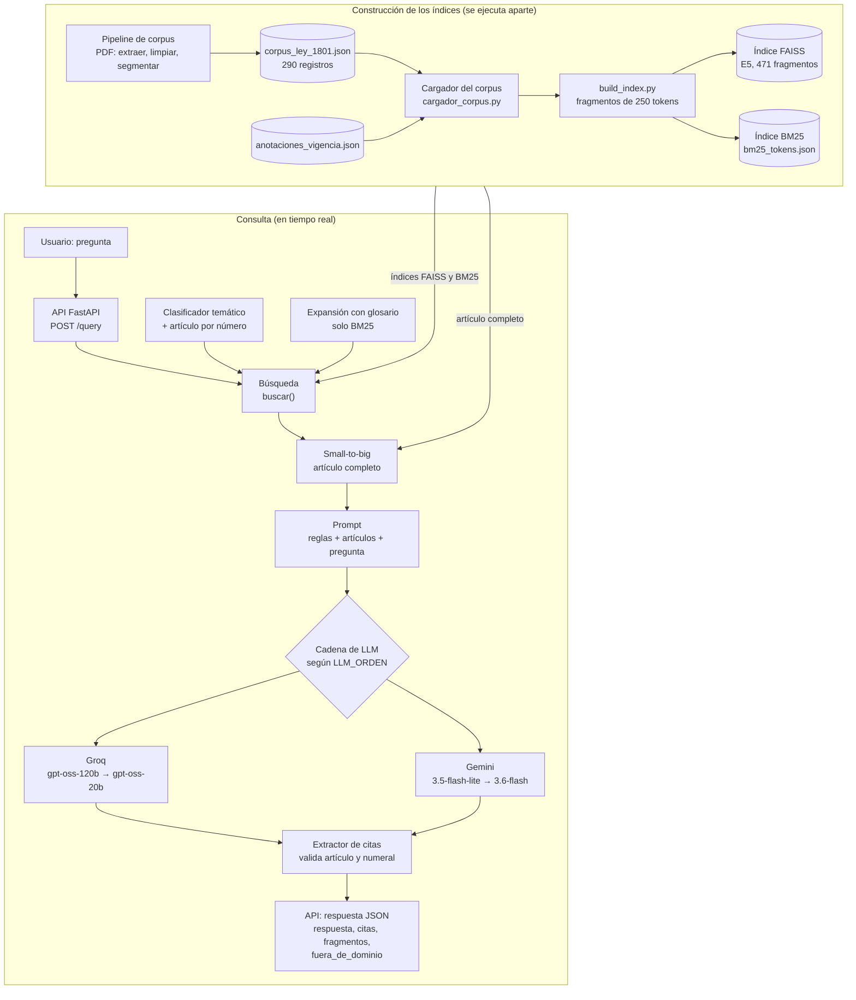

# Informe de avance: chatbot RAG sobre el Código Nacional de Seguridad y Convivencia Ciudadana

**Proyecto:** `policia-rag-chatbot` · **Corte:** 12 de noviembre de 2026 (último commit revisado: `c3dbdc7`) · **Entrega final:** viernes 20 de noviembre de 2026.

Este informe es la base del informe técnico final. Todo lo que dice sale del repositorio: el código, los documentos de `docs/`, los resultados de las evaluaciones y el historial de git. Cuando un dato no está guardado en el repositorio, aparece como **«pendiente de verificar»**; los datos que aportó el responsable del motor y que no quedan en el repo se señalan como tales.

---

## 1. Resumen ejecutivo

**Qué es.** Un chatbot que responde preguntas en español sobre la Ley 1801 de 2016 (Código Nacional de Seguridad y Convivencia Ciudadana) y cita el artículo, numeral o parágrafo que sustenta cada afirmación. Usa una arquitectura RAG (*Retrieval-Augmented Generation*): primero busca en el texto de la ley los fragmentos más parecidos a la pregunta y luego le pide a un modelo de lenguaje que responda **solo** con esos fragmentos. Si la respuesta no está en la ley, lo dice y no inventa.

**Qué funciona hoy (12/11):**

- **Corpus real** de la Fase 1: 290 registros extraídos de 11 PDF oficiales (249 artículos de la ley base y 41 disposiciones de normas que la reforman), con vigencia por artículo.
- **Motor de búsqueda** sobre los 249 artículos (471 fragmentos): búsqueda semántica con `intfloat/multilingual-e5-base` y FAISS, búsqueda léxica BM25 opcional, clasificador temático, búsqueda por número de artículo y expansión con glosario.
- **Generación con citas**: prompt anti-alucinación, validación de cada cita contra el texto recuperado, marcas `[INEXEQUIBLE: …]` en las expresiones que la Corte anuló, y una cadena de proveedores LLM (Groq y Gemini, cada uno con un modelo de respaldo).
- **API** FastAPI con `GET /health`, `POST /query` y `POST /upload_pdf/`. En la prueba del 12/11 respondió las 7 preguntas de demostración (HTTP 200) y detectó bien las 2 preguntas fuera de dominio.
- **Análisis lingüístico** (Santiago Castro): estadísticas, frecuencias, n-gramas, colocaciones y KWIC.

**Qué falta para el 20/11:**

1. **Frontend y backend** (Fase 5, responsable Santiago Bulla): no hay commits suyos; el frontend es un *placeholder* y el backend es el esqueleto inicial. Sin ellos no se cumple RF5 (mostrar las fuentes en la interfaz) ni el despliegue de pruebas.
2. **Evaluación formal** (Fase 6): el banco de 50 preguntas existe, pero no tiene el formato que lee `eval/run_eval.py`, que todavía es un esqueleto; `eval/reporte.md` está vacío.
3. **Corpus**: la vigencia es por artículo, no por numeral; solo hay 5 artículos con expresiones inexequibles anotadas; falta `docs/segmentacion.md` (sección 1) y el campo `tema` útil para el clasificador.
4. **Glosario definitivo** de Santiago Castro: su registro describe un borrador de 49 términos, pero el repositorio todavía tiene el glosario semilla de 18.
5. **Informe técnico (≤ 15 páginas), video de 5 minutos y sustentación.**

---

## 2. Arquitectura



El bloque superior se ejecuta una vez (y otra vez cuando cambia el corpus); el inferior, en cada pregunta.

Hay versiones interactivas y verificadas contra el código en [`docs/diagramas/`](diagramas/README.md) (arquitectura, estructura del repositorio y flujo de una consulta).

**Qué hace cada pieza:**

| Pieza | Qué hace |
|---|---|
| Pipeline de corpus | Extrae el texto de los PDF página por página, lo limpia y lo separa en artículos con expresiones regulares. Guarda archivo y páginas de origen de cada artículo. |
| Cargador del corpus | Lee el JSON del corpus y lo adapta al esquema del motor **sin modificar el archivo** (ver sección 4.1). Marca las expresiones inexequibles. |
| `build_index.py` | Parte cada artículo en trozos de 250 tokens con 50 de solapamiento, los convierte en vectores con E5 y construye los dos índices. Se ejecuta aparte; los índices no se versionan. |
| Índice FAISS | Guarda los vectores normalizados (`IndexFlatIP`: producto punto = similitud coseno). Sirve para la búsqueda por significado. |
| Índice BM25 | Guarda el texto de cada trozo preparado para búsqueda por palabras (minúsculas, sin stopwords, stemming o lematización). |
| Clasificador temático | Detecta el tema de la pregunta por palabras clave y **suma un empuje** al score de los fragmentos de ese tema (no filtra). Si la pregunta dice «artículo 163», ese artículo va primero. |
| Expansión con glosario | Si la pregunta usa jerga («guaro», «boleta»), agrega a la consulta BM25 las palabras del término legal. No toca la búsqueda semántica. |
| Búsqueda | Combina lo anterior según `BUSQUEDA_MODO` (`semantico` por defecto, `lexico` o `hibrido`) y devuelve los 3 mejores fragmentos, uno por artículo. |
| Small-to-big | Busca con trozos pequeños, pero le entrega al LLM el **artículo completo** de cada trozo. |
| Prompt | Instrucciones fijas: responder solo con los artículos dados, citar cada afirmación, avisar la vigencia y usar una frase fija cuando la respuesta no está. |
| Cadena de LLM | Prueba los proveedores en el orden de `LLM_ORDEN`; cada uno tiene un modelo de respaldo. Si todos fallan, la API responde 503. |
| Extractor de citas | Lee las citas de la respuesta y descarta las de artículos que no estaban en el contexto o de numerales que el artículo no tiene. |
| API | Valida la entrada, orquesta todo y devuelve el JSON del contrato ([`docs/api_contract.md`](api_contract.md)). |

---

## 3. Estructura de carpetas y código

### 3.1 Árbol de archivos versionados

Salida de `git ls-files` (sin `.venv`, índices, caché ni `.env`, que están en `.gitignore`). El autor sale de `git log` por archivo; entre paréntesis, el número de commits si hay más de un autor.

```text
policia-rag-chatbot/
├── .env.example                      Variables de entorno de ejemplo (claves vacías)               · Duvan
├── .gitignore                        Excluye .env, .venv, índices, uploads y PDF de docs/          · Duvan
├── README.md                         Instalación, ejecución y limitaciones                         · Duvan (7), Wilder (1)
├── backend/                          Proxy Express hacia el motor (esqueleto inicial)
│   ├── package.json                  Dependencias: express, cors, dotenv, multer                   · Duvan
│   └── src/server.js                 Reenvía /query y /upload_pdf; CORS por ORIGENES_PERMITIDOS    · Duvan
├── frontend/                         Pendiente (placeholder)
│   ├── README.md                     Dice que el framework está por definir                         · Duvan
│   └── package.json                  Sin dependencias; el script dev solo imprime un aviso          · Duvan
├── corpus/                           Fase 1: corpus de la Ley 1801
│   ├── README_corpus.md              Cómo se construye el corpus y formato de cada registro        · Wilder (2), Duvan (1)
│   ├── construir_corpus.py           Ejecuta el pipeline completo                                  · Wilder
│   ├── extraer.py                    Texto por página de cada PDF                                  · Wilder
│   ├── limpiar.py                    Quita encabezados repetidos (Gestor Normativo de Función Pública) · Wilder
│   ├── segmentar.py                  Separa artículos y arma los registros                          · Wilder
│   ├── documentos/                   11 PDF: Ley 1801 y normas que la modifican o adicionan         · Wilder
│   ├── procesados/
│   │   ├── corpus_ley_1801.json      Corpus que usa el motor (290 registros)                        · Wilder
│   │   ├── corpus_ley_1801_sin_verificar.json  Mismos 290 registros con vigencia «no_verificada»  · Wilder
│   │   └── texto_extraido/           12 JSON con el texto por página de cada PDF                     · Wilder
│   ├── anotaciones_vigencia.json     Expresiones declaradas inexequibles (5 artículos)              · Duvan
│   ├── preguntas_ley_1801.json       Banco de 50 preguntas                                          · Wilder
│   ├── muestra/                      Corpus de muestra de 10 artículos (opcional)                   · Duvan (2), Wilder (1)
│   │   ├── README.md                 Fuente y criterio de vigencia de la muestra
│   │   └── codigo_muestra.json       Los 10 artículos
│   └── raw/.gitkeep                  Carpeta reservada                                              · Duvan
├── engine/                           Motor RAG (Python)
│   ├── api.py                        API FastAPI: /health, /query, /upload_pdf/                    · Duvan (10), Wilder (1)
│   ├── requirements.txt              Dependencias de Python                                         · Duvan (4), Wilder (1)
│   ├── indexing/
│   │   ├── cargador_corpus.py        Adapta el corpus al esquema del motor y aplica anotaciones     · Duvan
│   │   ├── embeddings.py             Modelo E5, prefijos query/passage y ruta del corpus            · Duvan
│   │   ├── build_index.py            Construye los índices FAISS y BM25                             · Duvan (5), Wilder (1)
│   │   ├── uploads.py                Guarda y valida los PDF subidos                                · Duvan
│   │   └── indexes/.gitkeep          Aquí se generan los índices (no se versionan)                 · Duvan
│   ├── retrieval/
│   │   ├── search.py                 Búsqueda semántica, léxica e híbrida (RRF)                     · Duvan (10), Wilder (1)
│   │   ├── clasificador.py           Tema por palabras clave y artículo por número                  · Duvan
│   │   ├── expansion.py              Expansión de la consulta BM25 con el glosario                  · Duvan
│   │   └── temas.json                Temas, palabras clave y empuje por modo                        · Duvan
│   ├── generation/
│   │   ├── responder.py              Orquesta búsqueda, small-to-big, LLM y citas                   · Duvan
│   │   ├── prompt.py                 Reglas del asistente y armado del mensaje                      · Duvan (4), Wilder (1)
│   │   ├── llm.py                    Gemini y Groq, respaldos y LLM_ORDEN                           · Duvan
│   │   └── citas.py                  Extrae y valida citas de artículo, numeral y parágrafo         · Duvan
│   ├── preprocess/
│   │   ├── texto_bm25.py             Preparación de texto para BM25 (spaCy o Snowball)              · Duvan
│   │   └── extraer_senado.py         Script de referencia para el HTML del Senado                   · Duvan
│   ├── glossary/sinonimos.json       Glosario semilla (18 términos, provisional)                     · Duvan
│   └── analysis/                     Fase 2: análisis lingüístico
│       ├── estadisticas.py           Tokens, tipos, POS, NER, montos y plazos                       · Santiago Castro
│       ├── frecuencias.py            Lemas, n-gramas, colocaciones y KWIC                           · Santiago Castro
│       └── probar_glosario.py        Muestra qué coloquiales activa cada pregunta                   · Santiago Castro
├── eval/                             Fase 6: evaluación
│   ├── comparar_segmentacion.py      articulo vs fragmentos                                         · Duvan
│   ├── comparar_clasificador.py      Con y sin clasificador                                         · Duvan
│   ├── comparar_modos.py             semántico, léxico e híbrido                                    · Duvan
│   ├── comparar_expansion.py         Híbrido con y sin expansión                                    · Duvan
│   ├── calibrar_empuje.py            Empuje equivalente del clasificador por modo                   · Duvan
│   ├── preguntas_*.json              19 preguntas de las comparaciones (10 + 3 + 3 + 3)            · Duvan
│   ├── run_eval.py                   Evaluación general (esqueleto, sin implementar)               · Duvan
│   ├── banco_preguntas.json          Vacío (lista sin preguntas)                                    · Duvan
│   ├── ejemplo_formato.json          Formato esperado de cada pregunta del banco                    · Duvan
│   └── reporte.md                    Vacío                                                          · Duvan
└── docs/
    ├── api_contract.md               Contrato de la API                                             · Duvan (11), Wilder (1)
    ├── segmentacion.md               Segmentación del corpus y para indexación                      · Duvan (2), Wilder (2)
    ├── clasificador.md               Clasificador temático y su evaluación                           · Duvan
    ├── busqueda_hibrida.md           BM25, RRF, expansión y sus evaluaciones                        · Duvan
    ├── demo_entrega.md               Guion de la demo                                               · Duvan
    ├── informe_avance.md             Este informe                                                    · Duvan
    ├── diagramas/                    3 diagramas (HTML, PNG y JSON fuente) y README                 · Duvan
    ├── analisis/                     Resultados y notas del análisis lingüístico                    · Santiago Castro
    │   ├── estadisticas_base.json / estadisticas_todo.json
    │   ├── frecuencias_base.json / frecuencias_todo.json
    │   ├── kwic_base.txt / kwic_todo.txt
    │   ├── glosario_notas.md         Decisiones del borrador de glosario
    │   └── registro_trabajo.md       Registro de lo hecho y hallazgos
    ├── guia-companeros/              Plan de trabajo y una guía por integrante                      · Duvan
    │   ├── PLAN_TRABAJO.md, README.md, wilder.md, santiago-castro.md, santiago-bulla.md
    └── informe/.gitkeep              Carpeta para el informe técnico final                          · Duvan
```

Las carpetas `engine/generation/`, `engine/glossary/`, `engine/preprocess/`, `engine/retrieval/`, `engine/analysis/` y `docs/analisis/` también tienen un `.gitkeep` vacío (Duvan). **Santiago Bulla no tiene commits** en el repositorio.

### 3.2 Dónde está cada cosa

| Funcionalidad | Archivo | Función principal |
|---|---|---|
| Cargar el corpus | [`engine/indexing/cargador_corpus.py`](../engine/indexing/cargador_corpus.py) | `cargar()` (usa `adaptar()` y `aplicar_anotaciones()`) |
| Construir los índices | [`engine/indexing/build_index.py`](../engine/indexing/build_index.py) | `construir()`; por línea de comandos, `main()` |
| Calcular embeddings | [`engine/indexing/embeddings.py`](../engine/indexing/embeddings.py) | `embeddings_articulos()`, `embeddings_preguntas()` |
| Buscar | [`engine/retrieval/search.py`](../engine/retrieval/search.py) | `buscar()` (puntajes en `_puntajes_base()`) |
| Clasificar el tema | [`engine/retrieval/clasificador.py`](../engine/retrieval/clasificador.py) | `clasificar()`, `empujes()`, `articulos_mencionados()` |
| Expandir la consulta | [`engine/retrieval/expansion.py`](../engine/retrieval/expansion.py) | `expandir()`, `tokens_consulta_lexica()` |
| Preparar texto para BM25 | [`engine/preprocess/texto_bm25.py`](../engine/preprocess/texto_bm25.py) | `tokens_bm25()` |
| Small-to-big | [`engine/retrieval/search.py`](../engine/retrieval/search.py) | `articulo_completo()` |
| Armar el prompt | [`engine/generation/prompt.py`](../engine/generation/prompt.py) | `SISTEMA`, `construir_mensaje()` |
| Generar la respuesta | [`engine/generation/responder.py`](../engine/generation/responder.py) | `responder()` |
| Llamar al LLM | [`engine/generation/llm.py`](../engine/generation/llm.py) | `generar()`, `orden_proveedores()` |
| Extraer citas | [`engine/generation/citas.py`](../engine/generation/citas.py) | `extraer_citas()`, `existe_en_articulo()` |
| API | [`engine/api.py`](../engine/api.py) | `health()`, `query()`, `upload_pdf()` |
| Subir PDF | [`engine/indexing/uploads.py`](../engine/indexing/uploads.py) | `guardar()` |

---

## 4. Qué se hizo, por qué y cómo (por fase)

### 4.1 Fase 1: corpus lingüístico (20 %) · Wilder

**Qué se hizo.** Wilder construyó el corpus a partir de 11 PDF guardados en `corpus/documentos/` (la Ley 1801 y normas que la modifican, adicionan o corrigen). El pipeline (`extraer.py` → `limpiar.py` → `segmentar.py`, orquestado por `construir_corpus.py`) produce `corpus/procesados/corpus_ley_1801.json` con 290 registros:

| Tipo de disposición | Registros |
|---|---|
| Texto de la ley base (artículos 1 a 243, más 185A, 185B, 185C, 223A, 234A y 237B) | 249 |
| Corrige | 16 |
| Modifica | 12 |
| Modifica y adiciona | 8 |
| Adiciona | 5 |

**Fuente.** Por los encabezados que quita `limpiar.py`, los PDF vienen del Gestor Normativo (EVA) de la Función Pública. La **fecha de consulta** no está registrada en `corpus/README_corpus.md`: **pendiente de verificar** (la tiene que dar Wilder). Las anotaciones de vigencia sí registran su fuente: HTML de la Secretaría del Senado, consulta del 2026-11-09.

Vigencia (una por registro): `vigente` 168, `efecto_integrado` 41, `vigente_modificado` 41, `inexequible` 30, `vigente_con_inexequibilidad_parcial` 4, `vigente_condicionado` 2, `vigente_modificado_condicionado` 2 y `vigente_modificado_con_inexequibilidad_parcial` 2. Cada registro guarda el PDF y las páginas de origen.

**Por qué se adaptó el cargador y no el corpus.** El corpus usa un formato distinto del que esperaba el motor. Para no tocar el trabajo de Wilder, la adaptación se hace al cargar ([`cargador_corpus.py`](../engine/indexing/cargador_corpus.py), commit `88ffb76`). Se descartó editar el JSON a mano porque cada regeneración del corpus borraría los cambios.

| Problema del formato | Dato | Adaptación |
|---|---|---|
| `ubicacion` es un texto, no un objeto | 290 de 290 registros | Se convierte en `{libro, titulo, capitulo, articulo}`; el texto original queda en `ubicacion_texto`. Libro y capítulo se reconstruyen con los encabezados; el título no (el PDF no trae la línea «TÍTULO N»). |
| Encabezados de la sección siguiente pegados al final del artículo | 42 artículos | Se quitan del texto y se usan para ubicar los artículos siguientes. |
| Marcas vacías `*jurisprudencia*` | 6 artículos | Se quitan. |
| Ids con letra en minúscula (`art-185a`) | 6 ids: 185a, 185b, 185c, 223a, 234a y 237b | Se normalizan a mayúscula (`art-185A`), como los escribe la ley y las citas del modelo. |
| Registros de normas reformatorias | 41 | **Se excluyen por defecto** (`CORPUS_INCLUIR_REFORMAS=0`): su efecto ya está integrado en el texto del artículo y el motor todavía no sabe citar artículos de otras normas. |

**Anotaciones de vigencia.** La vigencia es por artículo, pero la ley cambia por numeral: el artículo 140, numeral 7, tiene expresiones declaradas inexequibles («bebidas alcohólicas», «psicoactivas o»; sentencia C-253 de 2019). Antes de este cambio el chatbot podía presentar ese numeral como una prohibición vigente. Solución provisional: [`corpus/anotaciones_vigencia.json`](../corpus/anotaciones_vigencia.json) lista las expresiones tachadas (etiquetas `<S>`) del HTML de la Secretaría del Senado, y el cargador las marca en el texto como `[INEXEQUIBLE: …]`. Hoy tiene 5 artículos y 6 expresiones (117, 134 num. 1, 140 num. 7, 220 y 237B); la del artículo 117 no se encontró en el texto del corpus ([`docs/guia-companeros/wilder.md`](guia-companeros/wilder.md)). La solución de fondo, la vigencia por numeral en el corpus, sigue pendiente.

**Banco de preguntas.** [`corpus/preguntas_ley_1801.json`](../corpus/preguntas_ley_1801.json) tiene 50 preguntas: 40 sobre normas reformatorias y 10 fuera de dominio, las 10 de tránsito. Usa campos en inglés (`question`, `answer`, `source`, `expected_behavior`), distintos de los de [`eval/ejemplo_formato.json`](../eval/ejemplo_formato.json).

### 4.2 Fase 2: análisis lingüístico (15 %) · Santiago Castro

Integrado en el commit `3cf1a21` (PR #4). Fuente de los datos: [`docs/analisis/registro_trabajo.md`](analisis/registro_trabajo.md).

- **spaCy en lugar de Stanza.** En su equipo spaCy carga con `es_core_news_sm` 3.8.0 y lematiza bien («multaron» → «multar»), así que no hizo falta Stanza.
- **Estadísticas** ([`estadisticas.py`](../engine/analysis/estadisticas.py)):

  | | Solo ley base | Todo el corpus |
  |---|---|---|
  | Registros | 249 | 290 |
  | Tokens | 53.443 | 68.654 |
  | Tipos (formas / lemas) | 4.884 / 3.701 | 4.942 / 3.756 |
  | Relación tipo/token | 0,0914 | 0,072 |
  | Longitud media / mediana por registro | 214,6 / 130 | 236,7 / 143,5 |

- **Frecuencias y KWIC** ([`frecuencias.py`](../engine/analysis/frecuencias.py)), ley base: «multa» 353 ocurrencias, «medida correctiva» 137, «espacio público» 66, «comparendo» 22. Bigrama más frecuente: «multa general» (237).
- **Hallazgos útiles para el motor:** el NER genérico de spaCy es ruidoso en texto jurídico (etiqueta «numeral» como lugar), así que conviene usar reglas propias para autoridades, plazos y montos; la ley casi no habla de SMDLV sino de «Multa General tipo N»; la gente dice «comparendo», pero el Código dice sobre todo «multa».
- **Glosario.** El registro describe un borrador de 49 términos legales y 339 coloquiales, con notas en [`docs/analisis/glosario_notas.md`](analisis/glosario_notas.md). **Ese borrador no está en el repositorio:** `engine/glossary/sinonimos.json` sigue siendo la semilla de 18 términos y 83 coloquiales escrita por Duvan. Pendiente de entrega.

### 4.3 Fase 3: representación vectorial e indexación · Duvan

**Modelo de embeddings: `intfloat/multilingual-e5-base`** ([`docs/segmentacion.md`](segmentacion.md)). Es multilingüe, gratuito y corre en el equipo, así que ni el texto ni las preguntas salen a un servicio externo (relevante para la Ley 1581). Acepta 512 tokens por texto, frente a 128 de `paraphrase-multilingual-MiniLM`. Vectores de 768 dimensiones, normalizados, con los prefijos `query: ` y `passage: ` que pide el modelo. **Alternativa descartada:** los embeddings de OpenAI (de pago, con clave y enviando el texto fuera del equipo).

**El límite de 512 tokens obliga a segmentar.** En la muestra de 10 artículos, 4 superaban el límite. El artículo 140 tiene 1.416 tokens: con un solo vector por artículo se pierden unos dos tercios, justo los numerales sobre sustancias en parques y la tabla de multas.

**Comparación de segmentación** (`eval/comparar_segmentacion.py`): `articulo` (un vector por artículo) frente a `fragmentos` (trozos de 250 tokens con 50 de solapamiento). En la muestra ganó `fragmentos` en MRR (0,850 frente a 0,792) y en las 4 preguntas cuya respuesta estaba después del token 512 (4 de 4 frente a 3 de 4). Con el corpus real la diferencia es mucho mayor: MRR de 0,403 con `articulo` frente a 0,708 con `fragmentos`, y 4 de 4 preguntas con respuesta después del token 512 en los 3 primeros puestos con `fragmentos` frente a 2 de 4 con `articulo` (medido el 12/11; detalle en [`docs/segmentacion.md`](segmentacion.md)). Tablas en la sección 5.1. Se eligió `fragmentos`.

**Small-to-big.** Los trozos se parten a veces a mitad de frase, así que la búsqueda usa trozos pero al LLM se le entrega el artículo completo de cada trozo ([`responder.py`](../engine/generation/responder.py), paso 2; `articulo_completo()` en `search.py`). Así se gana precisión al buscar sin perder contexto al responder.

**Índice.** FAISS `IndexFlatIP` sobre vectores normalizados. Con el corpus real son 471 fragmentos.

### 4.4 Fase 4: recuperación y generación · Duvan

**Clasificador temático y artículo por número** ([`docs/clasificador.md`](clasificador.md)). El clasificador es por palabras clave ([`temas.json`](../engine/retrieval/temas.json), 10 temas), determinista y gratuito. **Empuja, no filtra**: suma 0,03 × confianza al score de los fragmentos del tema, para no perder un buen resultado si el tema se detecta mal. Si la pregunta dice «artículo 163», ese artículo va primero. En la muestra mejoró el MRR de 0,808 a 0,865, y casi toda la mejora de Acierto@1 vino de la regla del artículo por número.

**Con el corpus real el empuje por tema no actúa.** El campo `tema` de los 249 artículos base vale «texto fuente Ley 1801», y ninguno coincide con los 10 temas de `temas.json` (0 de 249). Hoy solo funciona la regla del artículo por número. Medido el 12/11 ([`docs/clasificador.md`](clasificador.md)): con el clasificador el MRR pasa de 0,622 a 0,699, pero toda la mejora viene de una sola pregunta (p11, «artículo 163»), y con un empuje de 0 a 0,12 el resultado es idéntico. Para que el empuje funcione, el corpus debe traer temas reales y `temas.json` debe usar esos mismos nombres (Wilder y Santiago Castro).

**BM25 + RRF y por qué el modo por defecto cambió** ([`docs/busqueda_hibrida.md`](busqueda_hibrida.md)):

- BM25 encuentra términos exactos que la búsqueda semántica pierde: «Ley 1566 de 2012», «smdlv». RRF (*Reciprocal Rank Fusion*, k = 60) combina las dos listas por posición, sin tener que normalizar los scores.
- **Muestra de 10 artículos:** ganó el híbrido (MRR 0,927 frente a 0,859 del semántico), y quedó como modo por defecto.
- **Corpus real de 249 artículos:** el orden se invirtió. El semántico gana (MRR 0,701) y el híbrido queda en 0,650. Con muchos artículos, BM25 trae los que solo comparten vocabulario jurídico común, y la fusión empeora el buen orden semántico. Desde el 12/11 el modo por defecto es `semantico` (commit `919ffa1`). El híbrido queda como opción en `BUSQUEDA_MODO`.

**Expansión con glosario y corrección del falso positivo.** La expansión agrega a la consulta BM25 las palabras del término legal cuando la pregunta usa jerga. La primera versión detectaba los coloquiales por raíces del stemmer, y Snowball reduce «caso» y «casa» a la misma raíz (`cas`): la pregunta «¿Qué pasa si no hago caso cuando un agente…?» activaba «casa» → domicilio, y además «agente», un término demasiado genérico. **Corrección** (commit `e365a7e`): detectar por palabras completas y quitar «agente» del glosario. Resultado en la muestra (híbrido, 19 preguntas): MRR de 0,912 sin expansión a 0,947 con la versión corregida, sin ninguna pregunta peor. **Con el corpus real (12/11) el resultado es mixto** ([`docs/busqueda_hibrida.md`](busqueda_hibrida.md)): ayuda con la jerga (en las 3 preguntas coloquiales, el MRR pasa de 0,317 a 0,567), pero una pregunta que antes acertaba (p12, «mi perro suelto en el parque») baja del puesto 1 al 2, y en las 16 preguntas originales el MRR baja de 0,650 a 0,618. En las 19 el resultado es casi neutro (MRR de 0,597 a 0,610). La conclusión «ninguna pregunta empeora» solo vale para la muestra. Con el modo semántico por defecto, la expansión no actúa, porque solo afecta a BM25.

**Prompt anti-alucinación** ([`prompt.py`](../engine/generation/prompt.py)). Reglas principales:

1. Responder solo con los artículos que vienen en el mensaje, sin conocimiento propio.
2. Citar cada afirmación con formato fijo: `(Art. 163, num. 2)`, `(Art. 163, par. 1)`, `(Art. 180, par. transitorio)`.
3. No mezclar numerales con parágrafos en una misma lista.
4. Si los artículos no responden la pregunta, contestar solo con la frase fija «No encontré esa información en el Código…». La API detecta esa frase y marca `fuera_de_dominio: true`.
5. Avisar la vigencia cuando el artículo no es `vigente`.
   - Regla 5b: las expresiones marcadas `[INEXEQUIBLE: …]` ya no rigen; no hay que presentarlas como vigentes.
6. Escribir en lenguaje claro.
7. No dar asesoría jurídica personalizada.

**Validación de citas** ([`responder.py`](../engine/generation/responder.py) y [`citas.py`](../engine/generation/citas.py)). La API solo devuelve citas de artículos que estaban en el contexto y de numerales o parágrafos que existen en el texto de ese artículo; las demás se descartan.

**Cadena de proveedores LLM** (según el historial de git):

| Commit | Cambio | Causa registrada |
|---|---|---|
| `7d81541` | Principal `gemini-3.8-flash`, respaldo `gemini-3.6-flash` | Primera versión |
| `bbebf82` | Principal `gemini-3.5-flash-lite`; memoria de modelos caídos (180 s) | El 9/11, `gemini-3.8-flash` falló en todas las llamadas de tres corridas de prueba, con errores 503 y 504 (saturación del plan gratuito); con `flash-lite` respondieron 5 de 5 preguntas. *Dato aportado por Duvan: el mensaje del commit no registra la causa.* El commit agrega la memoria de caídos por 503/504/tiempo agotado |
| `919ffa1` | Razonamiento mínimo de Gemini (`LLM_RAZONAMIENTO=minimal`) | En `llm.py`: con el mismo prompt bajó de 14,4 a 9,7 s y de 3,6 a 1,6 s |
| `05e1105` | **Groq** como respaldo entre empresas: `openai/gpt-oss-120b` y, si da 429, `openai/gpt-oss-20b` | Si los dos Gemini fallan (503/504, tiempo agotado, 429). El límite gratuito de tokens por minuto de Groq es por modelo |
| `e66b696` | **`LLM_ORDEN`** configurable | Elegir qué proveedor va primero |

Reglas de la cadena ([`llm.py`](../engine/generation/llm.py)): cada llamada a Gemini tiene un plazo mínimo de 10 s (Gemini rechaza plazos menores) y la cadena de Gemini tiene un presupuesto total de 21 s; Groq tiene su propio plazo (`GROQ_TIMEOUT_S`, 15 s). Un 429 de Groq con espera corta se reintenta y, si no, pasa al otro modelo. **Orden actual:** sin `LLM_ORDEN` (valor de `.env.example`), Gemini primero y Groq de respaldo; para la demo, [`docs/demo_entrega.md`](demo_entrega.md) usa `LLM_ORDEN=groq,gemini`.

### 4.5 Fase 5: interfaz, API y despliegue

**API** ([`engine/api.py`](../engine/api.py), Duvan; contrato en [`docs/api_contract.md`](api_contract.md)):

- `GET /health`: indica si el motor está listo y muestra el corpus, el modo de búsqueda, los modelos, `llm_orden` y los tiempos de carga, nunca las claves.
- `POST /query`: pregunta de máximo 500 caracteres e historial opcional de máximo 50 mensajes (se acepta, pero todavía no se usa). Responde `respuesta`, `citas`, `articulos_citados`, `fragmentos` (con vigencia, tema y páginas), `fuera_de_dominio` y `tema_detectado`. Si falla el LLM, responde 503.
- `POST /upload_pdf/` (RF4): **guarda el PDF sin regenerar los embeddings**. Queda como `pendiente_de_indexar` en `corpus/uploads/` y entra al buscador solo al reconstruir el índice con `--incluir-uploads`.
- El modelo y los índices se cargan al arrancar, no en la primera pregunta.

**Seguridad de la subida** ([`uploads.py`](../engine/indexing/uploads.py)): máximo 10 MB (413 si se pasa); el archivo debe empezar con la cabecera `%PDF`; se rechazan los PDF con contraseña, dañados o sin texto (escaneados); el nombre se limpia (sin carpetas como `../` ni caracteres especiales) y se le agrega la fecha.

**Privacidad (Ley 1581 de 2012).** El motor no registra en los logs el texto de las preguntas, las respuestas, el historial ni el nombre o contenido de los documentos subidos; solo estado, tiempos, modelo y conteos. Tampoco guarda las preguntas en disco. El contrato pide que el historial viva en el navegador.

**Backend y frontend.** `backend/src/server.js` es un esqueleto escrito por Duvan al crear el repositorio: reenvía `/query` y `/upload_pdf` al motor, con CORS restringido a `ORIGENES_PERMITIDOS`. No reenvía `/health`. El frontend no existe todavía. Las tareas de Santiago Bulla (historial, panel de fuentes, aviso legal, despliegue y video) no tienen commits.

### 4.6 Fase 6: evaluación

Lo hecho son **comparaciones de componentes** con preguntas escritas antes de evaluar (sección 5). La evaluación final que pide el enunciado está pendiente: 50+ preguntas, Precisión@k, Recall@k, MRR, exactitud, fidelidad, corrección de la cita y análisis de errores. `eval/run_eval.py` es un esqueleto, `eval/banco_preguntas.json` está vacío, `eval/reporte.md` está vacío, y el banco de Wilder necesita convertirse al formato de `eval/ejemplo_formato.json`. Además, el plan pide al menos 15 preguntas fuera de dominio y variedad de temas; el banco tiene 10 fuera de dominio, todas de tránsito.

---

## 5. Evaluaciones

### Qué significa cada métrica

Para cada pregunta se sabe qué artículo debería aparecer, y se mira en qué posición lo devuelve el buscador.

- **Acierto@1**: proporción de preguntas en las que el artículo correcto sale **primero**. 0,80 = 8 de cada 10.
- **Acierto@3**: proporción de preguntas en las que sale **entre los 3 primeros**. Es lo que importa para el chatbot, porque al LLM se le dan 3 artículos.
- **MRR** (*Mean Reciprocal Rank*): promedio de 1 ÷ posición. Primero vale 1; segundo, 0,5; tercero, 0,33. Resume en un número qué tan arriba sale la respuesta correcta; 1,0 es perfecto.

**Cuidado al leer las tablas:** son muestras pequeñas (10 a 19 preguntas). Con 10 preguntas, una sola mueve 10 puntos. Sirven para decidir entre opciones, no son una medida definitiva.

### 5.1 Segmentación (`eval/comparar_segmentacion.py`)

| Corpus | Estrategia | Acierto@1 | Acierto@3 | MRR |
|---|---|---|---|---|
| Muestra (10 artículos, 10 preguntas) | `articulo` | 0,70 | 0,90 | 0,792 |
| | `fragmentos` | **0,80** | 0,80 | **0,850** |
| **Real** (249 artículos, 471 fragmentos, 10 preguntas) | `articulo` | 0,20 | 0,60 | 0,403 |
| | `fragmentos` | **0,60** | **0,80** | **0,708** |

Con el corpus real, `articulo` solo acierta la mitad de las preguntas con respuesta después del token 512 en los 3 primeros puestos (MRR 0,208), mientras `fragmentos` acierta las 4 (MRR 0,875). Medido el 12/11/2026 (commit `f78023e`); detalle por pregunta en [`docs/segmentacion.md`](segmentacion.md).

### 5.2 Clasificador (`eval/comparar_clasificador.py`)

| Corpus | Configuración | Acierto@1 | Acierto@3 | MRR |
|---|---|---|---|---|
| Muestra (13 preguntas) | sin clasificador | 0,69 | 0,85 | 0,808 |
| | con clasificador | **0,77** | **0,92** | **0,865** |
| **Real** (13 preguntas) | sin clasificador | 0,54 | 0,69 | 0,622 |
| | **con clasificador** | **0,62** | **0,77** | **0,699** |

Medido el 12/11/2026. La mejora viene solo de p11 (artículo por número); el empuje por tema no actúa porque el campo `tema` del corpus no coincide con `temas.json`. Detalle en [`docs/clasificador.md`](clasificador.md).

### 5.3 Modos de búsqueda (`eval/comparar_modos.py`, con clasificador)

| Corpus | Modo | Acierto@1 | Acierto@3 | MRR |
|---|---|---|---|---|
| Muestra (10 artículos, 16 preguntas) | semántico | 0,75 | 0,94 | 0,859 |
| | léxico | 0,88 | 0,94 | 0,906 |
| | **híbrido** | **0,88** | **1,00** | **0,927** |
| Real (249 artículos, 471 fragmentos, 16 preguntas) | **semántico** | **0,62** | **0,75** | **0,701** |
| | léxico | 0,31 | 0,69 | 0,512 |
| | híbrido | 0,56 | 0,69 | 0,650 |

Tiempo por búsqueda en la muestra (mediana): semántico 140,6 ms, léxico 1,6 ms, híbrido 142,4 ms. Casi todo el tiempo es codificar la pregunta con el modelo de embeddings.

### 5.4 Expansión con glosario (`eval/comparar_expansion.py`, modo híbrido)

| Corpus | Expansión | Acierto@1 | Acierto@3 | MRR |
|---|---|---|---|---|
| Muestra (19 preguntas) | sin | 0,84 | 1,00 | 0,912 |
| | con, primera versión (por raíces) | 0,84 | 1,00 | 0,921 |
| | **con, corregida (palabras completas)** | **0,89** | 1,00 | **0,947** |
| **Real** (19 preguntas, híbrido) | sin | 0,47 | 0,63 | 0,597 |
| | con | 0,47 | **0,68** | **0,610** |
| Real, 16 preguntas originales | sin | **0,56** | 0,69 | **0,650** |
| | con | 0,50 | 0,69 | 0,618 |
| Real, 3 muy coloquiales | sin | 0,00 | 0,33 | 0,317 |
| | con | **0,33** | **0,67** | **0,567** |

Medido el 12/11/2026 con el glosario semilla de 18 entradas. Con el corpus real, la expansión ayuda con la jerga pero empeora una pregunta (p12); detalle en [`docs/busqueda_hibrida.md`](busqueda_hibrida.md).

### 5.5 Pruebas de las 7 preguntas por la API

Las preguntas de demostración son: licor en el parque (art. 140), ingreso a domicilio sin orden, descuento por pronto pago, qué es una medida correctiva, perros potencialmente peligrosos, y dos fuera de dominio (pase de conducción e impuesto predial).

| Prueba | Proveedor | Resultado | Fuente |
|---|---|---|---|
| 12/11, `LLM_ORDEN=groq,gemini`, 10 s entre preguntas | Groq: 6 con `gpt-oss-120b`, 1 con `gpt-oss-20b` tras un 429 | 7 de 7 con HTTP 200; de 1,2 a 4,8 s, salvo la del pase de conducción (12,8 s, por un 429 del primer modelo). Las 2 fuera de dominio salieron bien | [`docs/demo_entrega.md`](demo_entrega.md), sección 6 |
| Tiempos por etapa en esa prueba | — | Búsqueda de 0,1 a 0,3 s; LLM con Groq de 1,1 a 4,7 s; total típico de 1,2 a 4,8 s; Gemini de 2,7 a 6,8 s, y más de 10 s con 503/504 | [`docs/diagramas/fuentes/flujo-consulta.json`](diagramas/fuentes/flujo-consulta.json) |
| Arranque del motor en frío | — | De 42 a 64 s (la carga del motor en sí, de 12 a 17 s) | [`docs/demo_entrega.md`](demo_entrega.md) |
| Fuera de dominio con la muestra y el modo híbrido | Gemini | Pase de conducción y predial con `fuera_de_dominio: true` (3,54 s y 1,30 s); control en dominio con cita del art. 180 (1,22 s) | [`docs/busqueda_hibrida.md`](busqueda_hibrida.md) |
| Corridas anteriores solo con Gemini y con Groq de respaldo (12/11) | — | **Pendiente de verificar**: el detalle por pregunta no quedó guardado en el repositorio | — |

---

## 6. Trazabilidad con el enunciado

| Requisito | Estado | Evidencia | Responsable |
|---|---|---|---|
| RF1. Responde preguntas en lenguaje natural, en español claro | **Cumple** (en la API) | `POST /query`; prompt regla 6; prueba de 7 preguntas en [`demo_entrega.md`](demo_entrega.md) | Duvan |
| RF2. Cita los artículos que sustentan la respuesta | **Cumple** (en la API) | Prompt regla 2; validación de citas en [`responder.py`](../engine/generation/responder.py) y [`citas.py`](../engine/generation/citas.py) | Duvan |
| RF3. Si no está en el corpus, lo dice y no inventa | **Cumple**; falta medirlo con el banco completo | Frase fija y `fuera_de_dominio`; 2 de 2 fuera de dominio en la prueba de la API | Duvan (banco: Wilder) |
| RF4. `POST /upload_pdf/` sin regenerar embeddings | **Cumple** | [`uploads.py`](../engine/indexing/uploads.py); el PDF queda `pendiente_de_indexar` | Duvan |
| RF5. La interfaz muestra los fragmentos recuperados | **Parcial**: la API los devuelve, pero no hay interfaz | Campo `fragmentos` de `/query`; [`frontend/README.md`](../frontend/README.md) es un placeholder | Santiago Bulla |
| RNF1. Respuesta en menos de 10 s | **Parcial**: típico de 1,2 a 4,8 s, pero el peor caso medido fue 12,8 s, y Gemini con 503/504 pasa de 10 s | [`demo_entrega.md`](demo_entrega.md); presupuesto de 21 s de Gemini en `llm.py` | Duvan |
| RNF2. Claves en variables de entorno, nunca en el repositorio | **Cumple** | [`.gitignore`](../.gitignore) excluye `.env`; solo se versiona [`.env.example`](../.env.example), con claves vacías | Santiago Bulla (motor: Duvan) |
| RNF3. El backend restringe orígenes con CORS | **Parcial**: el código existe en el esqueleto, pero el backend no está terminado ni probado | [`backend/src/server.js`](../backend/src/server.js) | Santiago Bulla |
| RNF4. Git, documentado y reproducible | **Parcial**: el motor es reproducible; falta el frontend y completar el backend | [`README.md`](../README.md), [`engine/requirements.txt`](../engine/requirements.txt), [`backend/package.json`](../backend/package.json) | Santiago Bulla (motor: Duvan) |

---

## 7. Problemas encontrados y cómo se resolvieron

| Problema | Evidencia | Solución |
|---|---|---|
| **spaCy bloqueado por Windows** en el equipo del líder: «Control de aplicaciones» bloquea una extensión nativa (`preshed/maps.pyd`) | [`docs/busqueda_hibrida.md`](busqueda_hibrida.md) | Respaldo automático con el stemmer Snowball, en Python puro. El índice guarda qué método usó y el motor arranca con `listo: false` si no coincide con el disponible. No se desactivó la protección de Windows. En el equipo de Santiago Castro spaCy sí carga. |
| **FAISS falla con rutas con tildes** (`…Beltrán…`) en Windows | Comentario en [`build_index.py`](../engine/indexing/build_index.py), `guardar_indice()`; regla 5 de [`guia-companeros/README.md`](guia-companeros/README.md) | El índice se serializa y se escribe con Python en lugar de `faiss.write_index`. |
| **Codificación UTF-8 en Windows**: `curl` y PowerShell rompen los acentos de las preguntas | [`docs/guia-companeros/santiago-bulla.md`](guia-companeros/santiago-bulla.md) | Probar con Postman o con scripts que envíen UTF-8; los scripts leen y escriben con `encoding="utf-8"`. |
| **Saturación de Gemini** (503, 504 por tiempo, 429 por límite) | `llm.py`; commits `bbebf82`, `919ffa1`, `05e1105`, `e66b696` | Reintento, modelo de respaldo, memoria de modelos caídos, razonamiento mínimo, Groq como segundo proveedor y `LLM_ORDEN`. Las evaluaciones corren con pausas de 8 a 10 s. |
| **Push directo a `main`** sin pull request | Commits `db87f91` y `e0fc58e` (Wilder), en la línea principal de `main` y sin merge | Regla 4 de las guías: todo entra por PR. Desde el 12/11 `main` está protegida en GitHub (configurada junto con el PR #7): pull request obligatorio, 0 aprobaciones, aplica a administradores y sin force-push. Se verificó con un push directo que GitHub rechazó con «Changes must be made through a pull request». Es una configuración del sitio, no un archivo del repositorio; los PR #8 y #9 ya entraron por esa regla. |
| **Repositorio en OneDrive**: sincroniza y bloquea archivos del entorno virtual; arranque lento | Regla 1 de [`guia-companeros/README.md`](guia-companeros/README.md); arranque de 42 a 64 s en [`demo_entrega.md`](demo_entrega.md) | Trabajar el repositorio fuera de OneDrive (`C:\dev\…`). El equipo del líder sigue en OneDrive: para la demo, arrancar el motor antes. |
| **`KeyError: 'fuentes'`** al construir el índice con el corpus real (solo algunos registros tienen ese campo) | Commit `88ffb76` | `build_index.py` lee los campos opcionales con `a.get()`. |
| **El corpus de muestra se borró** con la subida del corpus real (el motor apuntaba a él por defecto) | Commit `88ffb76`; hallazgo 5 de [`registro_trabajo.md`](analisis/registro_trabajo.md) | Se restauró la muestra; el corpus se elige con `CORPUS_RUTA` y por defecto es el real. |
| **Falso positivo de la expansión** («caso» → «casa») | Commit `e365a7e` | Detección por palabras completas; se quitó «agente» del glosario. |
| **El chatbot presentaba como vigente una expresión inexequible** (art. 140, num. 7) | Commit `919ffa1` | Anotaciones `[INEXEQUIBLE: …]` y regla 5b del prompt. |
| **`gpt-oss` respondía «No encontré…»** a la pregunta del licor en el parque, porque esa parte de la ley es inexequible | Commit `05e1105` | La regla 4 del prompt aclara que, si el artículo trata el tema aunque sea para decir que es inexequible, hay que responder. |
| **Índice BM25 inconsistente** si cambia el método de preparación (spaCy o Snowball) | [`docs/busqueda_hibrida.md`](busqueda_hibrida.md) | Verificación al arrancar: `listo: false` y mensaje que dice cómo reconstruir el índice. |
| **El trabajo de Santiago Castro estaba en un ZIP**, fuera de git | Pendiente 7 de [`registro_trabajo.md`](analisis/registro_trabajo.md) | Se integró con el PR #4 (commit `3cf1a21`). |

---

## 8. Limitaciones conocidas y riesgos para la demo

**Limitaciones:**

1. **Vigencia por artículo, no por numeral.** Fuera de las 6 expresiones anotadas, el motor solo puede advertir que se verifique en la fuente oficial.
2. **El empuje del clasificador no actúa con el corpus real** (0 de 249 temas coinciden); solo funciona la búsqueda por número de artículo. Con el corpus real, p09 y p13 no se encuentran con ningún método.
3. **Las 41 reformas no se indexan** y el motor no sabe citar artículos de otras normas. El banco de Wilder tiene 40 preguntas sobre esas reformas, así que hoy casi todas fallarían por diseño.
4. **Las evaluaciones son de muestras pequeñas** (10 a 19 preguntas, escritas para la muestra de 10 artículos). Con el corpus real ya están las cuatro comparaciones (segmentación, clasificador, modos y expansión), pero falta la evaluación con el banco de 50+ preguntas.
5. **BM25 usa stemming, no lematización**, en el equipo del líder (spaCy bloqueado).
6. **El glosario es la semilla provisional** de 18 términos, y la expansión no actúa en el modo semántico por defecto.
7. **El historial de conversación se acepta, pero no se usa**: cada pregunta se responde sola.
8. **Los documentos subidos no se citan bien**: el extractor de citas solo entiende «Art. N» ([`README.md`](../README.md)).

**Riesgos para la demo:**

| Riesgo | Mitigación |
|---|---|
| El arranque tarda de 42 a 64 s | Levantar el motor unos 2 minutos antes ([`demo_entrega.md`](demo_entrega.md)). |
| Límites del plan gratuito (429 de Groq, 503 de Gemini) | Dejar 10 s o más entre preguntas; cambiar `LLM_ORDEN` y reiniciar si un proveedor falla. |
| Una respuesta tarda más de 10 s | La cadena de respaldo responde, pero puede tardar; usar las 5 preguntas verificadas del guion. |
| No hay interfaz web | La demo se hace en `http://localhost:8000/docs` (Swagger). |
| Faltan los índices en un equipo nuevo | Construirlos antes: unos 17 minutos en total en CPU. |

---

## 9. Pendientes hacia la entrega final (20/11)

Según las guías de [`docs/guia-companeros/`](guia-companeros/README.md) y el estado real del repositorio. Prioridad: **A** = sin esto no hay entrega; **B** = afecta la nota; **C** = mejora.

| Persona | Prioridad | Pendiente |
|---|---|---|
| **Santiago Bulla** | A | Frontend de chat con historial, panel de fuentes (RF5) y aviso legal visible. |
| | A | Terminar el backend: proxy también de `/health`, CORS probado y `package.json` completo (RNF3, RNF4). |
| | A | Despliegue en entorno de pruebas y video de 5 minutos con una pregunta fuera de dominio. |
| **Wilder** | A | Convertir el banco de 50 preguntas al formato de `eval/ejemplo_formato.json` (`pregunta`, `respuesta_referencia`, `articulos_esperados`, `fuera_de_dominio`); agregar preguntas sobre los artículos base, más temas y al menos 15 fuera de dominio, no solo de tránsito. |
| | B | Completar `corpus/anotaciones_vigencia.json` con las demás sentencias y revisar las entradas con `revisado_a_mano: false`; a futuro, vigencia por numeral. |
| | B | Llenar el campo `tema` con temas reales (coordinado con Santiago Castro y `temas.json`). |
| | B | Sección 1 de [`docs/segmentacion.md`](segmentacion.md) (regex, criterios y casos borde) y fecha de consulta de las fuentes en [`corpus/README_corpus.md`](../corpus/README_corpus.md). |
| **Santiago Castro** | A | Subir el glosario definitivo a `engine/glossary/sinonimos.json` (el borrador de 49 términos no está en el repositorio). |
| | B | Reorganizar `engine/retrieval/temas.json` con la estructura real de la ley y los temas del corpus. |
| | B | Informe de análisis lingüístico en `docs/analisis/` y su sección del informe técnico. |
| **Duvan** | A | Implementar `eval/run_eval.py` (Precisión@k, Recall@k, MRR, exactitud, fidelidad, cita) y llenar `eval/reporte.md` con análisis de errores. |
| | A | Con el glosario definitivo y los temas reales del corpus, repetir las comparaciones del clasificador y de la expansión (hoy, con el corpus real, el clasificador no actúa y la expansión empeora p12). |
| | A | Compilar el informe técnico (≤ 15 páginas) a partir de este documento. |
| | B | Revisar RNF1 (peor caso de 12,8 s) y el tiempo de arranque. |
| | C | Indexar y citar las normas reformatorias si el banco final las mantiene. |
| **Todos** | A | Ensayo de la sustentación: cada uno debe poder explicar el flujo completo. |

---

## 10. Cómo ejecutar el proyecto

- Instalación, índices y arranque del motor: sección **«Motor RAG (engine/)»** del [README](../README.md#motor-rag-engine).
- Guion de la demo (arranque, 5 preguntas, qué mostrar y qué hacer si un proveedor falla): [`docs/demo_entrega.md`](demo_entrega.md).
- Contrato de la API: [`docs/api_contract.md`](api_contract.md).
- Diagramas: [`docs/diagramas/`](diagramas/README.md).
